# Clean Room — Privileged

# Aster Data-Mesh Streaming DAG Design

Date: 2026-10-19

Status: approved design; implementation planning pending

Supersedes the unreleased execution model in the prior Blob streaming branch,
including `2026-10-17-end-to-end-blob-streaming-design.md`. It preserves the
useful protocol, transport, application-streaming, lifecycle, and sequential-pack
foundations described below, but replaces Blob-specific serial processing with a
measured, partitioned data-mesh execution engine.

## Decision and compatibility boundary

Aster is not production-deployed. Semantic v9/profile 5 is unreleased and has
no deployed compatibility authority. This work therefore redefines that same
semantic/profile allocation rather than allocating another version or retaining
the previous v9 behavior as a fallback.

Semantic v7/v8 profile 4 remains an older negotiated protocol. Profile-4 partial
state cannot be resumed as profile 5. No migration is required for provisional
profile-5 data produced by development builds. Completed development data must
be explicitly reimported or its development depot reset if its physical format
is incompatible.

The implementation branch starts at canonical main commit
`fcf9f1b054f9623b61435659994fad0bc6c51779`, which includes merged PR 47 Blob
lifecycle policy. The reference previous-streaming implementation is local
commit `d092cce2d2df590644bf7d63c5f41b0e12375afe` from PR 97. Carry-forward is
selective and test-driven; it does not make that branch an architectural
authority.

## Capability and claim boundary

This increment advances the roadmap outcome **Authenticated resumable Blob
movement** and the P2 **Representative DDIL and target-resource fitness** track.
Blob is the first enabled adapter for the general engine. Event, State, Record,
and Control integration points are designed now but are not claimed as enabled
until their own adapters and evidence exist.

The outcome is a bounded-memory Blob pipeline whose storage, cryptography,
framing, transport, verification, and durability stages overlap. Under a
declared CM4 hardware and network profile, every non-transport stage must show
enough measured capacity that the selected transport is the limiting
steady-state stage.

This is evaluation-stage work. It does not claim production fitness, arbitrary
hardware fitness, independent interoperability, BTLE, multipath, route-only Blob
custody, or release authorization.

## Goals

1. Execute data movement as an explicit measured DAG rather than one synchronous
   Blob callback loop.
2. Partition expensive independent work and execute it concurrently in bounded
   worker pools.
3. Preserve canonical ordering through a bounded reorder/merge operator rather
   than serial cryptographic dependency.
4. Reduce independent segment leaves into deterministic plaintext and ciphertext
   roots.
5. Use cumulative durable checkpoints as stream watermarks and sole byte-progress
   authority.
6. Keep application ingestion, local persistence, transport, remote persistence,
   and application output streaming and bounded.
7. Retain transport-blind public APIs and automatically select one eligible
   transport per attempt.
8. Measure queueing, active processing, downstream blocking, and resource use at
   every operator so the real critical path is observable.
9. Reuse scheduling, backpressure, buffers, supervision, metrics, cancellation,
   and error machinery for future data-class adapters.
10. Validate exact 800-MiB and 1-GiB transfers on the three existing CM4 devices.

## Non-goals

- No multipath striping, cross-peer swarming, erasure coding, speculative
  duplicate transfer, or compression.
- No new semantic version or compatibility fallback for the old development v9
  format.
- No general distributed map-reduce framework, persistent job scheduler, or
  per-partition database row.
- No Event, State, Record, or Control activation in the first implementation.
- No promise that transport is the physical bottleneck on every machine or link.
- No unbounded per-partition trace retention.

## Carry-forward from the previous streaming work

The new branch must preserve behavior, not blindly preserve code. The following
pieces are retained where their focused tests prove that they fit the new DAG:

- semantic-v9/profile-5 negotiation and fail-closed profile selection;
- the transport adapter seam and the first Iroh/QUIC implementation;
- authenticated stream-open, accept, data, checkpoint, finish, result, and
  result-ack control concepts;
- absolute receiver credit and cumulative checkpoint progress;
- authenticated provisional publication admission and atomic final promotion;
- append-only sequential ciphertext packs with alternating crash-safe checkpoint
  generations;
- single-pass local publish and authenticated read application APIs;
- resumable agent and `asterctl` streaming surfaces;
- finite-TTL lifecycle, quota, pressure, deletion-fence, and policy integration
  inherited from merged PR 47;
- direct data-frame decoding without redundant payload copies where ownership is
  safe;
- automatic selection of one data-carrying transport per attempt; and
- focused protocol vectors, boundary tests, hostile-input tests, and benchmark
  harnesses that remain semantically valid.

The following previous mechanisms are replaced:

- the `previous_ciphertext_commitment` dependency between adjacent segments;
- a stateful ordered decryptor as the only verification path;
- synchronous reader and receiver callbacks inside the transport driver;
- Blob-only scheduling and metric structures;
- receiver processing under one state mutex;
- serial decode, authentication, pack append, and checkpoint advancement;
- any instrumentation that reports only aggregate transfer rate without queue,
  service, and blocked-time attribution; and
- temporary PR-only packaging workflow edits.

## Data-mesh execution DAG

Every transfer is one immutable `StreamJob` executed by the shared engine.

```mermaid
flowchart LR
    subgraph Sources[Sources]
        AP[Application publish stream]
        LP[Completed local pack]
        RP[Remote peer inventory]
    end

    subgraph Plan[Admission and planning]
        AU[Authenticate peer and source]
        PO[Policy and lifecycle]
        QO[Quota and resource admission]
        TS[Select one transport]
        JP[Create stream job]
    end

    subgraph Send[Sender data plane]
        RD[Sequential read]
        PT[Partition]
        MW[Parallel map workers]
        OM[Bounded ordered merge]
        RR[Root reduction]
        LB[Local pack batcher]
        TW[Transport frame batcher]
        LD[Local group durability]
    end

    subgraph Receive[Receiver data plane]
        RX[Transport receive]
        FP[Incremental parser]
        DP[Partition dispatch]
        VW[Parallel verify map]
        RO[Bounded ordered merge]
        PB[Pack-write batcher]
        DC[Durable group checkpoint]
        FR[Root and final verification]
        PR[Atomic promotion]
    end

    subgraph Sinks[Mesh and application sinks]
        IV[Inventory and index]
        RC[Reconciliation frontier]
        RS[Authenticated read stream]
        FW[Eligible forwarding source]
    end

    AP --> AU
    LP --> AU
    RP --> AU
    AU --> PO --> QO --> TS --> JP
    JP --> RD --> PT --> MW --> OM
    MW --> RR
    OM --> LB --> LD
    OM --> TW --> RX --> FP --> DP --> VW --> RO
    VW --> FR
    RO --> PB --> DC
    RR --> FR
    LD --> FR
    DC --> FR
    FR --> PR
    PR --> IV
    PR --> RC
    PR --> RS
    PR --> FW
```



The solid graph is the data dependency DAG. Credit, backpressure, cancellation,
and tuning are control-plane signals and do not change dependency truth.

## Job, partition, and result model

A `StreamJob` contains:

- authenticated job, logical-stream, source, and attempt identities;
- data-class adapter and canonical open metadata;
- source and required sink capabilities;
- partitioning and reduction strategy;
- memory, worker, descriptor, and in-flight-byte budgets;
- durability and completion policy;
- selected transport; and
- cancellation/supervision root.

For Blob, a partition is identified by:

```text
(stream_id, segment_index, plaintext_offset, plaintext_length, open_digest)
```

The current profile fixes the maximum Blob segment plaintext at 1 MiB. This is
an authenticated format invariant shared by segment offsets, AEAD records,
Merkle leaves, packs, checkpoints, resume indices, and transport framing; it is
not a local throughput or total-transfer limit and cannot be changed by one
node's runtime configuration. The existing measurements show that this framing
is not the current critical-path bottleneck, but they do not establish 1 MiB as
the globally optimal segment size. Any future size alternatives require
comparative device evidence and explicit protocol negotiation that binds the
selected canonical size into the authenticated open. Runtime adaptation remains
free to tune worker concurrency, bounded in-flight extents, credit, batching,
and transport selection without changing the format.

A map result is immutable and includes:

- the complete expected job and partition identities;
- canonical encoded segment bytes;
- plaintext and ciphertext Merkle leaves;
- byte/item counts and operation timings; and
- a typed success or failure outcome.

No worker mutates shared stream progress. Only the ordered merge and durable
checkpoint operators advance their respective watermarks.

## Independent segment authentication

The current chained ciphertext commitment prevents parallel map execution and
must be removed. Each segment is independently protected and binds at least:

```text
stream ID
open digest
format and content epoch
segment index
plaintext offset
plaintext and ciphertext lengths
declared total length
ciphertext
AEAD tag
```

Nonce derivation is deterministic from a per-publication random base nonce and
the checked segment index. Associated data includes the canonical open digest
and all structural fields. Reorder, overlap, truncation, substitution,
cross-stream replay, and changed intent fail verification.

Workers compute domain-separated plaintext and ciphertext leaves independently.
Adjacent ranges reduce into deterministic binary Merkle subtrees. A subtree is
identified by its first segment and covered count; only aligned adjacent ranges
may combine. The final roots therefore commit to both bytes and canonical order
without requiring worker `n` to consume worker `n-1`'s state.

## Ordered merge and reduction

Mapped partitions may complete out of order. A bounded reorder buffer keyed by
partition index releases only the next contiguous result to sequential sinks.
Its byte ceiling is part of the stream memory budget.

The root reducer can compute ready subtrees concurrently, but the durable
checkpoint records only the Merkle frontier for the completed contiguous pack
prefix. No out-of-order result becomes durable progress merely because its map
work completed.

The fixed-width frontier is sized for the profile's maximum checked Blob length
and segment size. It is constant-sized with respect to actual Blob length and
contains no implementation-private hash state.

## Bounded execution and scheduling

The engine uses fixed worker pools and bounded byte queues, never one task per
segment. Total live memory must satisfy:

```text
source buffers
+ queued map input
+ active worker buffers
+ reorder buffer
+ pack batch
+ transport window
<= configured stream/global memory budget
```

The initial four-core CM4 policy reserves one asynchronous runtime/network lane,
uses two CPU map workers, and one sequential storage lane. One large Blob job is
active until measurements prove safe concurrency. This is an initial policy,
not a protocol rule.

Work stealing is allowed only among equivalent map workers. Canonical ordering,
checkpoint publication, pack append, lifecycle transitions, and transport
control remain single-authority operations.

Concurrency changes apply only at checkpoint boundaries and use hysteresis.
They must remain inside configured CPU, memory, descriptor, and fairness limits.
Control and Event capacity is reserved so a large Blob cannot starve higher
priority mesh work.

## Local pack and transport fan-out

Fresh publication maps plaintext once and exposes the same owned encrypted
segment to two bounded consumers:

```text
mapped segment --+--> sequential local pack
                 +--> live transport branch
```

The local pack is the durable spool. If the transport branch falls behind, it
releases live buffers after the local checkpoint and later reads canonical
encrypted records from the pack. It does not block local publication
indefinitely, retain an unbounded queue, or decrypt/re-encrypt.

A completed-publication replication job starts directly at pack read and skips
plaintext segmentation/encryption. An authenticated application read starts at
pack read, maps independent verification/decryption, restores order, and emits
bounded plaintext frames.

For semantic-v9/profile-5 replication, the network record operator protects
only the fixed canonical StreamData header with the mission record layer. The
already source-encrypted, independently authenticated pack segment remains an
adjacent body in the same bounded carrier message. One StreamData record carries
exactly one length-prefixed pack segment; transport, map, Merkle-reduction, and
checkpoint partitions therefore share one boundary without sender slicing or
receiver reassembly. The receiver authenticates the header and exact declared
body length before the segment enters the
verification map. It does not decrypt and re-encrypt the segment through a
second full-payload mission envelope. Control records remain wholly
mission-protected. This preserves the zero-trust content boundary at the source
segment AEAD while removing redundant per-byte cryptography from the transport
hot path.

## Backpressure and watermarks

Each edge has independent item and byte limits; byte limits are authoritative.
When a downstream queue fills, backpressure propagates to admission or the
source. No stage allocates in proportion to Blob length.

Progress positions are distinct:

```text
accepted offset >= processed offset >= durable offset
```

Only the durable offset survives restart or is advertised to a peer. It is the
stream-processing watermark for the contiguous committed prefix.

## Checkpoint authority and ordering

A checkpoint contains:

- stream/open/pack-format identity;
- generation;
- next partition index;
- durable plaintext and pack offsets;
- plaintext and ciphertext Merkle frontiers;
- exact pack length;
- lifecycle generation; and
- checksum.

Commit ordering is:

1. gather a contiguous verified batch;
2. append canonical records to the pack;
3. synchronize pack data;
4. write the next alternating checkpoint generation;
5. synchronize the checkpoint;
6. publish the durable offset locally; and
7. send checkpoint acknowledgement and replenish absolute receiver credit.

The pack checkpoint journal is the sole byte-progress authority. Redb owns
lifecycle, quota, provisional roots, conflict evidence, and final publication
state, but cannot claim a newer byte position.

After a crash Aster selects the newest valid checkpoint, verifies all identities
and frontiers, truncates or ignores the uncheckpointed pack tail, restores the
reducers, and resumes at the recorded partition. Replay is bounded by the
advertised uncheckpointed window.

## Completion and promotion

Promotion is a multi-input reduction over:

- final local durable checkpoint;
- required remote durable checkpoint for a replication job;
- plaintext and ciphertext roots;
- exact lengths and segment count;
- publisher-signed finish;
- current authorization, lifecycle, quota, and deletion-fence checks; and
- canonical job/open identity.

Every required input must agree before atomic promotion. Provisional bytes are
absent from inventory, reads, and forwarding. An exact duplicate finish is
idempotent. A conflicting finish retains only bounded conflict evidence and can
never expose partial content.

Remote completion is not required for a local-only publication response. The
job descriptor declares required sinks explicitly.

## Failure and cancellation semantics

Execution is at least once; durable effects are idempotent and
checkpoint-authoritative. A failed or interrupted job may replay uncheckpointed
partitions.

- A transient map failure cancels volatile work and resumes from the last
  checkpoint.
- Authentication or integrity failure stops credit immediately and terminally
  rejects the attempt.
- Source failure retains the prior durable prefix according to lifecycle policy.
- Pack write/sync failure stops upstream admission and credit; the prior
  checkpoint remains authority.
- Transport disconnect detaches the network branch; local publication may
  continue.
- Policy, revocation, or TTL invalidation stops new work at a bounded validation
  point and prevents promotion.
- A worker panic cancels the structured job and cannot become partial success.
- Shutdown and explicit cancellation close admission, propagate cancellation,
  reclaim queued buffers, join every child, and only then release permits and
  key-bearing state.

One supervisor owns the source, map pool, reorder/reducer, pack writer,
transport writer, and metrics collector. No task may outlive it.

## Shared engine and data-class adapters

The engine owns:

- bounded queues and pooled buffer ownership;
- partition scheduling and map-worker supervision;
- ordered merge and generic reduction hooks;
- backpressure, cancellation, errors, and retries;
- transport framing and credit integration;
- metrics and critical-path attribution; and
- global fairness/resource admission.

Adapters define semantic partitioning, verification, reduction, and commit:

| Class | Partition | Map | Reduce and commit |
|---|---|---|---|
| Blob | segment index/range | hash, AEAD, encode/decode/verify | Merkle roots, pack checkpoint, final commitment |
| Event | publisher stream and sequence range | source/route verification | contiguous page validation and batched durable insert |
| State | topic/scope/key group | envelope verification | causal maxima and deterministic projection |
| Record | topic/scope/key group | envelope verification | authenticated head/conflict set |
| Control | authority sequence | bounded independent verification | strict ordered policy transition |

Small operations use stage fusion when queueing would cost more than the work.
Future adapters require their own atomicity, ordering, security, and evidence
review; their presence in this table is not an implementation claim.

## Transport selection

Application APIs remain transport-blind. Aster intersects locally enabled
adapters, authenticated peer capabilities, and policy, then selects one adapter
per attempt from retained health evidence. A healthy attempt is not interrupted
to chase a theoretical improvement.

A retry may choose a different eligible adapter under a fresh attempt nonce but
the same logical stream and receiver-authoritative checkpoint. Concurrent
data-carrying adapters for one attempt are forbidden in this increment.

The first implementation may register only Iroh. That proves the selector seam,
not best-among-multiple transport behavior.

## Measurement model

Every stage observation records:

```text
job and attempt ID
data class and stage
partition range
bytes/items in and out
queue wait
active service time
blocked-input and blocked-output time
CPU time when available
allocation and copy counts
worker count and batch size
checkpoint generation
transport adapter and selected route
typed result
```

Raw per-partition samples are aggregated into bounded counters and histograms.
Diagnostic tracing may sample partitions but cannot retain O(Blob length) state.

For each operator:

```text
service capacity = processed bytes / active service time
arrival rate = input bytes / observation interval
utilization = arrival rate / service capacity
```

A bottleneck candidate requires high utilization, persistent upstream pressure,
and downstream starvation. Queue wait must not be charged to active computation,
and downstream blocking must not be misreported as slow cryptography.

Metrics cover source read, partition, map, reduction, reorder, pack append, data
sync, checkpoint commit, pack read, transport send/receive, parse, verification,
promotion, and application output, plus queue watermarks, buffer occupancy,
reorder distance, partition skew, retransmission, peak RSS, CPU, descriptors,
and database transactions.

## Optimization policy

Optimization follows measured critical-path evidence:

1. remove synchronous barriers and avoidable copies;
2. fuse cheap adjacent operators;
3. batch storage, checkpoints, and transport frames;
4. partition expensive independent work;
5. increase bounded parallelism;
6. change partition/window sizes only with evidence; and
7. consider parallel transport lanes only after one lane is independently
   proven to be the remaining limit.

The controller may adjust worker concurrency, active partition count, reorder
window, frame aggregation, durability batch, transport credit, and live-buffer
versus pack sourcing. It cannot adjust authentication, cryptographic format,
canonical order, durability truth, lifecycle rules, or resource ceilings.

## Warm-up and physical validation

Every run separates setup, warm-up, steady-state measurement, and drain/finalize.
Warm-up includes connection establishment, route selection, worker/crypto
initialization, filesystem cache behavior, and congestion-window growth. Both
cold whole-operation and warm steady-state results are retained and labeled.

Validation uses the existing three CM4 devices. The selected network path and
the actual local/remote transport endpoints are recorded. ZeroTier remains
available for remote management and is not silently treated as evidence of a
specific local data path.

Validation order:

1. 64 MiB instrumentation sanity and warm-up;
2. 256 MiB stable-rate comparison;
3. exact 800 MiB customer regression;
4. exact 1 GiB transfer;
5. interrupted 1 GiB durable resume; and
6. three-CM4 contention and Event/control fairness.

## Performance acceptance

For the declared CM4 route and resource profile:

1. Publish, replicate, promote, and read exact 800-MiB and 1-GiB payloads with
   matching SHA-256 and Blob identity evidence.
2. Peak memory reaches a fixed streaming plateau and does not grow with Blob
   length.
3. Database commits and durability barriers scale with checkpoint batches, not
   frames or segments.
4. The successful publish path performs no whole-Blob staging or second
   plaintext pass.
5. Interrupted transfer resumes at the receiver-authoritative checkpoint with a
   retransmitted tail bounded by the advertised window.
6. End-to-end steady-state payload rate reaches at least 80% of raw selected
   transport payload rate under equivalent frame/window bounds.
7. Each isolated non-transport stage sustains at least 125% of that raw
   transport rate.
8. Throughput remains approximately stable from 256 MiB through 1 GiB after
   warm-up, with no per-segment latency multiplier.
9. Event and control work is not starved by the large Blob job.
10. The report identifies the limiting stage using queue, service, blocking, and
    resource evidence.

The earlier approximately 1.5-MiB/s CM4 result is only a regression baseline.
If the ratios fail, the run is not transport-limited even if absolute throughput
improves.

## Verification strategy

Implementation is test-driven at independently observable boundaries:

- canonical independent-segment and Merkle reduction vectors;
- equivalent roots across partition counts and completion orders;
- checkpoint frontier restoration and deterministic resume;
- reorder, overlap, truncation, duplicate, substitution, and cross-stream
  rejection;
- bounded queues, permits, and pooled buffers under success, cancellation,
  failure, and panic;
- backpressure without deadlock at pack and transport limits;
- pack crash points around data sync and alternating checkpoints;
- provisional invisibility and final promotion atomicity;
- local publish/read streaming without whole-object staging;
- remote resume and bounded retransmission;
- lifecycle, pressure, revocation, and TTL transitions during a stream;
- deterministic one-transport selection;
- stage-metric accounting invariants; and
- focused release benchmarks followed by CM4 qualification.

Parser/framing changes require protocol vectors and the repository fuzz-smoke
gate. Requirements evidence changes require
`tools/check-implementation-requirements.py`. Full repository validation is
delegated to CI when local resource limits make it unsafe; focused tests and
format/lint checks run locally.

## Implementation boundaries

Delivery is vertical rather than a sequence of disconnected micro-optimizations:

1. shared DAG types, bounded queues, supervision, metrics, and synthetic
   operator tests;
2. independent Blob segment authentication and deterministic parallel reduction;
3. checkpoint/frontier and pack integration;
4. local application publish/read adapters;
5. transport send/receive adapters with resume and promotion;
6. lifecycle/resource/fairness integration;
7. benchmark and critical-path reporting; and
8. two-CM4 then three-CM4 qualification.

No increment is considered successful if it converts data through the legacy
carrier-per-file depot, restores a serial cryptographic chain, stages complete
plaintext, acknowledges non-durable progress, or lacks operator-level
attribution.

## Approval record

The user approved replacing unreleased v9 without a new semantic version,
changing segment authentication and pack layout to permit independent parallel
processing, using a bounded staged DAG with ordered merge and deterministic
reduction, making Blob the first adapter for a reusable data-class engine, and
measuring/optimizing every operator using established stream-processing
practices. The user requested a separate branch from main carrying forward the
key functionality from the previous streaming PR.
