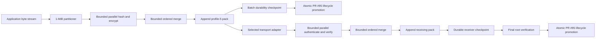

# Profile-5 Pack and Blob-Lifecycle Integration Design

Date: 2026-10-22

Status: approved design; implementation planning pending

## Decision

Restore the proven semantic-v9/profile-5 Blob data plane introduced by commit
`b81f4dab` and make the Blob lifecycle delivered by PR #95 the sole authority
for its canonical pack.

Profile 5 keeps its fixed 1-MiB independently authenticated `ASTRBS02`
segments, bounded parallel map/order/reduce pipeline, append-only pack,
checkpoint journal, and direct pack-to-pack network transfer. The lifecycle
owns publication identity, visibility, subscriptions, retention, quota,
leases, deletion, and final promotion without changing that representation.

This corrects the regression introduced by commit `2ad4e5cb`, which obtained
lifecycle integration by converting profile 5 to the legacy 64-KiB
`ASTRBT01` chunk representation and batching those chunks in `ABX1`. That
conversion is not required for a single semantic authority and caused the
observed publication and transfer regression.

## Supersession boundary

This design preserves the execution model in
`2026-10-19-aster-data-mesh-streaming-dag-design.md` and supersedes the
conflicting physical-representation and compatibility decisions in
`2026-10-21-pr110-review-remediation-design.md`.

In particular:

- one semantic Blob authority remains mandatory;
- the authority is the PR #95 Blob lifecycle;
- its physical variant for semantic v9/profile 5 is the profile-5 pack;
- a semantic authority does not require one physical format across protocol
  versions;
- profile 5 does not project data into 64-KiB canonical chunks;
- profile 5 does not carry `ASTRBT01` records or `ABX1` extents; and
- profile-4 compatibility and migration of unreleased development data are not
  requirements for this change.

Aster is not production-deployed, and semantic v9/profile 5 is unreleased.
Existing incompatible development depots may be reset or their content
reimported. No bidirectional representation conversion is added.

## Capability and claim boundary

This increment advances **Authenticated resumable Blob movement** and the P2
**Representative DDIL and target-resource fitness** track.

It implements and validates:

- offline-first local Blob publication;
- bounded-memory application ingestion and reads;
- direct transfer of the stored encrypted representation;
- receiver-checkpoint resume;
- PR #95 lifecycle, policy, and capacity behavior for profile-5 packs; and
- a measured 800-MiB and 1-GiB path on the existing three CM4 devices.

It does not claim production fitness, CLI download resume, BLE, multipath,
cross-peer swarming, Event/State/Record activation, or general release
authorization.

## Why the remediation regressed

The review finding was valid: the original profile-5 pack was not completely
integrated into the ordinary Blob lifecycle. The implementation response was
not valid: it treated the existing 64-KiB chunk store as the lifecycle itself.

The current path accepts provisional 1-MiB application segments, then reopens
and decrypts them during finalization, splits each into sixteen 64-KiB chunks,
encrypts the chunks again, and commits them through per-chunk storage work.
That adds thousands of database transactions and filesystem durability
operations to a 1-GiB publication.

Measured on the CM4 candidate:

- direct 1-GiB Iroh/QUIC transfer over WLAN: about 108.5 seconds and
  9.44 MiB/s;
- original profile-5 1-GiB local publication: about 105--108 seconds;
- regressed 1-GiB local publication: about 620 seconds; and
- the prior composite 1-GiB result: about 242 seconds end to end.

The transport is therefore not the cause of the ten-minute publication. The
representation conversion and per-chunk commit path are.

## Authority and representation

The implementation has one semantic authority and one profile-5 physical
variant:

| Concern | Authority |
| --- | --- |
| Publication identity and accepted order | PR #95 Blob lifecycle transaction |
| Topic, scope, publisher, epoch, priority, and TTL | PR #95 Blob lifecycle metadata |
| Subscription visibility and inventory | PR #95 Blob lifecycle indexes |
| Quota, leases, retention, pressure, and deletion | PR #95 Blob lifecycle policy |
| Durable byte progress | Profile-5 pack checkpoint journal |
| Stored encrypted bytes | Profile-5 append-only pack |
| Segment integrity and ordered whole-Blob commitment | Profile-5 segment AEAD and Merkle roots |
| Network progress | Receiver acknowledgements of durable pack checkpoints |

The lifecycle may reference a profile-5 pack as a physical variant. It must not
duplicate the pack's byte-progress state in redb or require conversion to a
legacy chunk manifest. The checkpoint journal remains the sole durable byte
watermark; redb remains the sole semantic publication and policy authority.

## Data plane

Fresh publication maps plaintext once. The completed encrypted segment is
eligible for both the sequential local-pack sink and a bounded live transport
sink. Local durability never waits indefinitely for a peer: when the transport
sink falls behind or no destination is available, it releases buffers and a
later synchronization reads the same segments from the durable pack.

Replication of an already completed publication starts at pack read and never
decrypts or re-encrypts source content. Authenticated application reads start
from the same pack, verify/decrypt independent segments in bounded workers,
restore order, and stream plaintext to the caller.

## Profile-5 representation and wire behavior

The behavioral reference is the profile-5 model at `b81f4dab`:

- `BLOB_STREAM_SEGMENT_BYTES` is 1 MiB;
- `EncryptedBlobStreamSegment` uses `ASTRBS02` framing;
- every segment binds stream/open identity, index, plaintext offset, exact
  lengths, declared total length, ciphertext, and authentication tag;
- independent plaintext and ciphertext leaves reduce to deterministic ordered
  roots;
- a completed pack is an ordered sequence of length-prefixed encrypted
  segments plus crash-safe checkpoint state; and
- the final segment may be shorter than 1 MiB.

Profile-5 DATA carries the exact stored encrypted records. A transport adapter
may fragment bytes to its own frame or MTU limits, but transport fragments are
not Aster Blob chunks, are not committed independently, and do not create a
second storage representation.

Semantic v9 negotiates profile 5 for Blob transfer. This PR retains the
transport-adapter seam and the first Iroh/QUIC adapter. It does not design a
second production adapter, hard-code transport selection into Blob semantics,
or prevent a future BLE adapter from carrying the same segment stream.

## Lifecycle integration

### Local publication

1. Authenticate and authorize the publication request.
2. Reserve capacity and create a lifecycle-owned provisional import.
3. Stream plaintext through the profile-5 pipeline into its temporary pack.
4. Advance accepted, processed, and durable offsets independently.
5. Verify final lengths and ordered roots.
6. Synchronize the completed pack and final checkpoint.
7. In one lifecycle transaction, recheck authorization, quota, deletion
   fences, operation-key intent, lineage, and policy; allocate final semantic
   identity; register the pack variant; and expose the publication.

Cancellation or failure before step 7 exposes no publication. The provisional
import and its capacity remain lifecycle-owned and can resume or be reclaimed
under the existing policy.

### Remote reception

1. Authenticate the exact source, custody claim, open metadata, and attempt.
2. Create or reopen lifecycle-owned pending reception state.
3. Resume at the last durable profile-5 partition boundary.
4. Authenticate and append received segments through the bounded pipeline.
5. Persist pack data before advancing the alternating checkpoint journal.
6. Verify the final source commitment and complete ordered roots.
7. Promote through the same lifecycle transaction used by ordinary Blob
   visibility, subscription, quota, retention, and conflict handling.

Exact duplicate completion is idempotent. A conflicting source, variant,
generation, lifetime, or commitment fails closed. Incomplete packs are absent
from reads, inventory, subscriptions, and forwarding.

### Reads, retention, and deletion

Every read and forwarding decision reuses PR #95 authorization and lifecycle
checks. Leases protect the pack while it is being read, transferred, finalized,
or promoted. Retirement removes semantic visibility first; physical pack
reclamation occurs only after the last root and lease permit it. Capacity is
released only after deletion completes according to the lifecycle's
restart-safe deletion rules.

## Durability, resume, and timeout semantics

Pack writes are synchronized in bounded checkpoint groups rather than once per
segment. A checkpoint records stream/open/format identity, generation, next
segment, durable plaintext and pack offsets, Merkle frontiers, exact pack
length, lifecycle generation, and checksum.

Commit ordering is:

1. append a contiguous ordered group;
2. synchronize pack data;
3. write and synchronize the next checkpoint generation;
4. publish the durable offset; and
5. acknowledge the checkpoint and replenish receiver credit.

After restart, Aster selects the newest valid checkpoint, rejects identity or
frontier mismatch, ignores or truncates the uncheckpointed suffix, restores
the reducers, and resumes at the next segment. Replay is bounded by the
checkpoint group. Client-side export/download resume remains post-merge work.

Timeouts are phase-specific:

- connection and authentication retain short fixed deadlines;
- active transfer uses a progress watchdog reset by verified durable progress;
- a size-derived safety bound prevents an indefinitely stalled attempt; and
- the generic contact deadline does not wrap and cancel a healthy large-Blob
  transfer.

Local publication has no network deadline and never requires coordination with
a destination.

## Public API and operator behavior

The Blob API, native agent RPCs, and `asterctl` surface introduced by PR #95
remain transport-blind. Users do not choose profile 5, segment size, or Iroh.

- Publish completion means the local Blob is durable and lifecycle-visible.
- Synchronization begins when a destination is available or requests content.
- Progress distinguishes accepted, processed, durable, transferred, verified,
  and promoted bytes.
- Status remains receiver-local durable state, not a convergence claim.
- Errors identify connection, authentication, storage, integrity, progress
  stall, or lifecycle failure rather than returning an undifferentiated
  contact timeout.

The selected transport consumes a generic bounded stream of authenticated
profile records. Future non-IP transports may fragment and schedule that stream
without changing the Blob API, lifecycle, or stored representation.

## Verification

### Automated coverage

- Empty, sub-segment, exact 1-MiB, multi-segment, and final-short-segment
  boundaries.
- Deterministic ordering and roots under out-of-order worker completion.
- Publication and reception restart at every durability boundary.
- Corruption, truncation, overlap, replay, wrong generation, and cross-stream
  substitution fail closed.
- Atomic promotion never exposes incomplete content.
- PR #95 retention, TTL, leases, quota, pressure, ownership, subscriptions,
  retirement, and deletion operate on profile-5 packs.
- Existing Blob API, agent, and CLI workflows remain covered.
- Protocol tests prove that profile 5 does not invoke `ASTRBT01`, `ABX1`, or
  the profile-4 Blob carrier path.
- Framing changes receive deterministic vectors, hostile-input coverage, and
  `mise run fuzz-smoke`.

Focused tests run during development. The repository gate and full suite run
once the focused implementation is stable; repeated local full-suite runs are
not used as the development loop.

### CM4 evidence

Use `rpi4-1`, `rpi4-2`, and `rpi4-3`. ZeroTier remains the remote-control and
SSH path. Payload traffic uses their `192.168.60.0/24` WLAN interfaces.

For warmed 800-MiB and 1-GiB transfers, record:

- raw WLAN transfer baseline;
- source read, partition, crypto, reorder, pack append, checkpoint durability,
  discovery, transport, receive verification, promotion, and destination-read
  timings;
- payload interface and direct/relay path;
- source, stored, transferred, and exported hashes;
- contact and progress errors;
- CPU, peak RSS, disk usage, and checkpoint count; and
- cold versus warmed startup cost.

Initial acceptance gates are:

- 1-GiB local publication returns to approximately 105--108 seconds rather
  than the regressed 620 seconds;
- destination read remains approximately 90--93 seconds;
- composite 1-GiB publish and synchronization is no slower than the previous
  approximately 242-second result;
- no active-progress contact timeout occurs;
- memory stays bounded independently of Blob length; and
- any material gap from the raw transport ceiling is attributed to a measured
  pipeline stage.

These are bounded CM4 evaluation gates, not universal product guarantees.

## Documentation and migration

The engineering runbook, performance report, protocol description, and
examples must describe the restored 1-MiB profile-5 representation. Statements
that profile 5 uses 64-KiB `ASTRBT01` chunks or `ABX1` extents become
superseded-development history, not current behavior.

No production migration exists. Opening an incompatible development depot must
fail explicitly with guidance to reset or reimport; it must not silently
reinterpret stored bytes or run an unmeasured conversion during startup.

## Implementation sequence

1. Restore the proven profile-5 core segment, pack, checkpoint, and bounded
   pipeline behavior from `b81f4dab` with focused tests.
2. Replace the 64-KiB finalization and carrier path with direct profile-5 pack
   ownership and transfer.
3. Bind provisional imports, pending receptions, final promotion, reads,
   subscriptions, quota, leases, retention, and deletion to PR #95 lifecycle
   records.
4. Preserve later valid fixes: content-proof binding, route-cache update after
   promotion, terminal EOF settlement, bounded public streaming surfaces, and
   phase/progress-aware deadlines.
5. Remove obsolete compatibility code, representation conversion, tests, and
   documentation.
6. Run focused correctness, failure, conformance, and hostile-input checks.
7. Build the exact candidate for ARM64 and validate the complete data plane on
   the three CM4 devices.
8. Retain performance evidence and run final CI/repository gates once.

The implementation is complete only when the lifecycle integration is proven
without reintroducing serial representation conversion and the CM4 acceptance
gates are met by the exact reviewed candidate.
